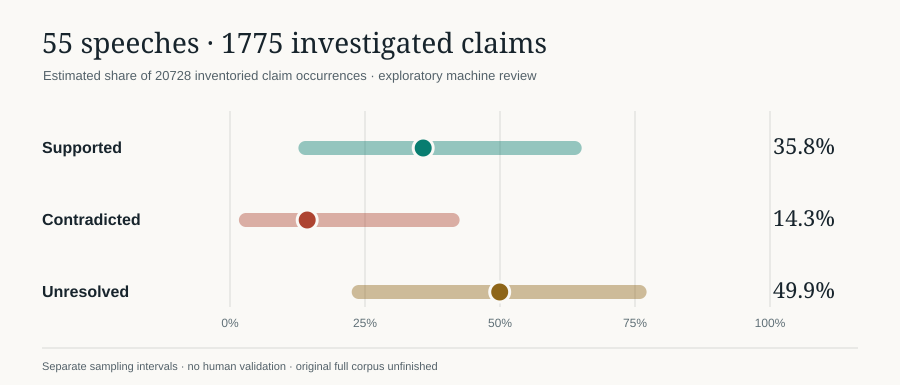

# Presidential speech findings

**1,825 investigated claims across 57 events**

Updated 03:12 UTC, 20 November 2026. The weighted estimates cover 55 audited speech frames. The Lincoln Memorial and CPAC excerpt samples each contribute 25 separate investigations.

| Investigations | Supported | Contradicted | Unresolved |
|---|---:|---:|---:|
| All reviewed | 732 | 257 | 836 |
| Initial 25-claim draw | 9 | 3 | 13 |
| Same draw after evidence rechecks | 11 | 5 | 9 |
| Second 25-claim draw | 9 | 1 | 15 |
| Second draw after rechecks | 9 | 1 | 15 |
| Clarksville initial random draw | 6 | 5 | 14 |
| Clarksville after evidence rechecks | 7 | 6 | 12 |
| Syracuse initial random draw | 6 | 6 | 13 |
| Syracuse after evidence rechecks | 6 | 7 | 12 |
| Columbus Day random draw | 12 | 2 | 11 |
| Science medals ceremony initial random draw | 12 | 3 | 10 |
| Science medals ceremony after evidence rechecks | 14 | 4 | 7 |
| San Antonio random draw | 7 | 1 | 17 |
| Trump Accounts announcement random draw | 13 | 5 | 7 |
| Sparrows Point maritime address initial random draw | 5 | 0 | 20 |
| Sparrows Point maritime address after evidence rechecks | 8 | 0 | 17 |
| Grand Island campaign rally initial random draw | 9 | 0 | 16 |
| Grand Island campaign rally after evidence rechecks | 9 | 1 | 15 |
| Vandalia campaign rally random draw | 10 | 3 | 12 |
| Mobile campaign rally initial random draw | 9 | 5 | 11 |
| Mobile campaign rally after evidence rechecks | 10 | 5 | 10 |
| Durant campaign rally random draw | 9 | 3 | 13 |
| Denton Peterbilt address random draw | 6 | 1 | 18 |
| Domestic-energy announcement opening random draw | 17 | 3 | 5 |
| National Hispanic Heritage Month celebration initial random draw | 6 | 6 | 13 |
| National Hispanic Heritage Month celebration after evidence rechecks | 7 | 6 | 12 |
| America.gov launch address initial random draw | 13 | 1 | 11 |
| America.gov launch address after evidence rechecks | 14 | 2 | 9 |
| State dinner honoring Xi Jinping random draw | 16 | 1 | 8 |
| Grand Foyer welcome for Xi Jinping random draw | 22 | 1 | 2 |
| Gulf Cooperation Council address initial random draw | 10 | 2 | 13 |
| Gulf Cooperation Council address after evidence rechecks | 10 | 3 | 12 |
| Shield of the Americas opening initial random draw | 11 | 1 | 13 |
| Shield of the Americas opening after evidence rechecks | 11 | 2 | 12 |
| United Nations General Assembly address initial random draw | 11 | 1 | 13 |
| United Nations General Assembly address after evidence rechecks | 11 | 2 | 12 |
| Prescription drug prices opening random draw | 12 | 5 | 8 |
| Rose Garden Club Dinner address random draw | 9 | 2 | 14 |
| Gastonia campaign rally random draw | 5 | 4 | 16 |
| Dublin embassy address random draw | 11 | 3 | 11 |
| September 11 Pentagon observance random draw | 16 | 0 | 9 |

## Weighted share within the studied speech frames

The 55 speech frames contain 20,728 claim occurrences. The study selected claims at random within each speech. An unresolved verdict means the claim received an evidence review. Two separate comparison samples add 50 investigations to the study total.

| Verdict | Estimate | Conservative 95% design interval |
|---|---:|---:|
| Supported | 35.8% | 14.0%–63.8% |
| Contradicted | 14.3% | 3.0%–41.2% |
| Unresolved | 49.9% | 23.8%–75.9% |

The weighted estimate includes 1,775 investigations from 20,728 audited claim occurrences. The intervals reflect sampling variation within these frames. The review is exploratory and machine-based.

<section class="direction-panel" id="unresolved-direction" aria-labelledby="direction-title">

836 unresolved claims · all investigated events

<h2 class="direction-title" id="direction-title">Direction of unresolved claims</h2>

Positive wording gives credit or describes a benefit. Negative wording assigns blame or describes harm. This chart codes wording. Audience effects require audience data.

<a class="direction-method" href="#direction-method">Read the coding method</a>

<dl class="direction-rows" aria-label="Rhetorical direction counts and shares">

<dt>Positive</dt>
<dd class="direction-track" aria-hidden="true"></dd>
<dd class="direction-value">334 · 40.0%</dd>

<dt>Negative</dt>
<dd class="direction-track" aria-hidden="true"></dd>
<dd class="direction-value">282 · 33.7%</dd>

<dt>Mixed</dt>
<dd class="direction-track" aria-hidden="true"></dd>
<dd class="direction-value">5 · 0.6%</dd>

<dt>Undetermined</dt>
<dd class="direction-track" aria-hidden="true"></dd>
<dd class="direction-value">215 · 25.7%</dd>

</dl>
</section>

## Why claims are unresolved

| Main reason | Claims | What it means |
|---|---:|---|
| Unclear definition or comparison | 280 | The wording leaves the measure, comparison, population or time period open. |
| Records cover only part | 336 | Public sources establish some details but leave a decisive part unverified. |
| No direct public record found | 153 | Research found no accessible source that directly answers the claim. |
| Spoken wording unverified | 2 | A recording or transcript is needed to establish the relevant words or attribution. |
| Cause not established | 65 | The record may show the outcome, but it does not establish what caused it. |

## Evidence follow-up

836 of 1,825 investigated claims remain unresolved (45.81%). The baseline was 51.91%. The research target is 40% or less.

Independent machine reviews rechecked 518 earlier unresolved claims. The review changed 87 verdicts and kept 431 unresolved. Each change answers the original claim under the existing evidence cutoff. Two random supplements added 50 investigations across the original 30 eligible frames. 25 additional speech frames each contribute a 25-claim random draw.

<h2 id="direction-method">Coding rhetorical direction</h2>

The unit is one unresolved claim occurrence. The quoted words and frozen interpretation determine its direction. Positive covers praise, favorable credit, and claimed benefits. Negative covers blame, allegations of wrongdoing, and adverse outcomes. Mixed is reserved for one claim with both directions. Undetermined covers descriptive wording and unclear referents whose direction would require guessing. Counts include the comparison samples. Measuring actual influence on attitudes or behavior requires audience data.

Independent machine coders initially agreed on 30 of 40 randomly audited prior cases. The sampled disagreements were reconciled.

## Counts by event

| Event | Inventoried | Investigated | Supported | Contradicted | Unresolved |
|---|---:|---:|---:|---:|---:|
| White House ballroom remarks | 182 | 39 | 9 | 4 | 26 |
| Bullhead City rally | 714 | 39 | 14 | 3 | 22 |
| Speech: Donald Trump Holds a Midterm Political Rally in Chillicothe, Ohio - October 28, 2026 | 555 | 40 | 12 | 6 | 22 |
| Corinth rally | 657 | 38 | 14 | 4 | 20 |
| Corpus Christi rally | 526 | 40 | 12 | 6 | 22 |
| Dalton rally | 582 | 36 | 12 | 8 | 16 |
| Speech: Donald Trump Holds a Midterm Political Rally in Daytona Beach, Florida - October 30, 2026 | 475 | 37 | 12 | 4 | 21 |
| Speech: Donald Trump Holds a Midterm Political Rally in Dubuque, Iowa - November 1, 2026 | 700 | 37 | 9 | 4 | 24 |
| Fort Myers rally | 552 | 39 | 17 | 5 | 17 |
| South Carolina tele-rally | 97 | 40 | 16 | 6 | 18 |
| Greenville rally | 639 | 38 | 17 | 6 | 15 |
| Highland Heights rally | 510 | 38 | 11 | 8 | 19 |
| Remarks: Donald Trump Holds a Virtual Tele-Rally for Indiana GOP Candidates - November 2, 2026 | 72 | 38 | 10 | 12 | 16 |
| Kalispell rally | 443 | 38 | 9 | 9 | 20 |
| Lubbock rally | 772 | 39 | 23 | 2 | 14 |
| Park City rally | 598 | 39 | 12 | 6 | 21 |
| Pendleton rally | 513 | 38 | 18 | 4 | 16 |
| Perry rally | 620 | 39 | 11 | 7 | 21 |
| Port Huron rally | 528 | 40 | 10 | 8 | 22 |
| Unscheduled White House press conference opening | 96 | 40 | 22 | 5 | 13 |
| Speech: Donald Trump Holds a Midterm Political Rally in Rock Hill, South Carolina - October 29, 2026 | 525 | 39 | 12 | 11 | 16 |
| Rose Garden first-responder lunch | 231 | 40 | 17 | 4 | 19 |
| Speech: Donald Trump Holds a Midterm Political Rally in Salina, Kansas - November 1, 2026 | 521 | 39 | 11 | 9 | 19 |
| Oval Office proclamation signing remarks | 27 | 27 | 20 | 4 | 3 |
| Sioux City rally | 537 | 39 | 15 | 7 | 17 |
| Kennedy Space Center transportation summit remarks | 126 | 40 | 31 | 3 | 6 |
| National Veterans Day Ceremony remarks | 124 | 38 | 20 | 3 | 15 |
| Wasilla rally | 507 | 39 | 13 | 6 | 20 |
| Women’s Health signing | 103 | 39 | 24 | 1 | 14 |
| Youngstown rally | 434 | 38 | 11 | 9 | 18 |
| Remarks at a Campaign Rally for Tennessee Republican Candidates in Clarksville, Tennessee | 588 | 25 | 7 | 6 | 12 |
| Remarks at a Campaign Rally for New York Republican Candidates in Syracuse, New York | 505 | 25 | 6 | 7 | 12 |
| Remarks at a Columbus Day Celebration | 418 | 25 | 12 | 2 | 11 |
| Remarks on Presenting the National Medal of Science and National Medals of Technology and Innovation | 160 | 25 | 14 | 4 | 7 |
| Remarks at a Campaign Rally for Texas Republican Candidates in San Antonio, Texas | 573 | 25 | 7 | 1 | 17 |
| Remarks on the Trump Accounts Children's Savings Program and an Exchange With Reporters | 89 | 25 | 13 | 5 | 7 |
| Remarks on Maritime Policy in Sparrows Point, Maryland | 355 | 25 | 8 | 0 | 17 |
| Remarks at a Campaign Rally for Nebraska Republican Candidates in Grand Island, Nebraska | 645 | 25 | 9 | 1 | 15 |
| Remarks at a Campaign Rally for Ohio Republican Candidates in Vandalia, Ohio | 602 | 25 | 10 | 3 | 12 |
| Remarks at a Campaign Rally for Alabama Republican Candidates in Mobile, Alabama | 453 | 25 | 10 | 5 | 10 |
| Remarks in Durant, Oklahoma | 618 | 25 | 9 | 3 | 13 |
| Remarks on the National Economy in Denton, Texas | 417 | 25 | 6 | 1 | 18 |
| Remarks on Domestic Energy Production | 135 | 25 | 17 | 3 | 5 |
| Remarks at a National Hispanic Heritage Month Celebration | 387 | 25 | 7 | 6 | 12 |
| Remarks on Improving Government Service Delivery Through Artificial Intelligence | 101 | 25 | 14 | 2 | 9 |
| Remarks at a State Dinner Honoring President Xi Jinping of China | 54 | 25 | 16 | 1 | 8 |
| Remarks at a Welcoming Ceremony for President Xi Jinping of China | 41 | 25 | 22 | 1 | 2 |
| Remarks During a Multilateral Meeting With the Gulf Cooperation Council in New York City | 122 | 25 | 10 | 3 | 12 |
| Remarks at a Meeting on the Shield of the Americas Initiative in New York City | 58 | 25 | 11 | 2 | 12 |
| Remarks to the United Nations General Assembly in New York City | 313 | 25 | 11 | 2 | 12 |
| Remarks on Prescription Drug Prices and an Exchange With Reporters | 75 | 25 | 12 | 5 | 8 |
| Remarks at a Rose Garden Club Dinner | 162 | 25 | 9 | 2 | 14 |
| Remarks at a Campaign Rally for North Carolina Republican Senatorial Candidate Michael D. Whatley in Gastonia, North Carolina | 493 | 25 | 5 | 4 | 16 |
| Remarks to United States Embassy Personnel and Business Leaders in Dublin, Ireland | 304 | 25 | 11 | 3 | 11 |
| Remarks on the 25th Anniversary of the September 11, 2001, Terrorist Attacks in Arlington, Virginia | 94 | 25 | 16 | 0 | 9 |
| Lincoln Memorial remarks (comparison) | 391 | 25 | 7 | 5 | 13 |
| CPAC dinner excerpt (comparison) | 45 | 25 | 9 | 6 | 10 |

The evidence and corpus cutoff is 12 November 2026 at 19:44:39 UTC. This research snapshot includes numerical records and selected evidence notes. The case ledger, full transcripts and retrieval logs remain in the research workspace.

- [Download numerical data](findings.json)
- [Download event-level data](../data/events.csv)
- [Read the study methodology](../docs/methodology.md)
